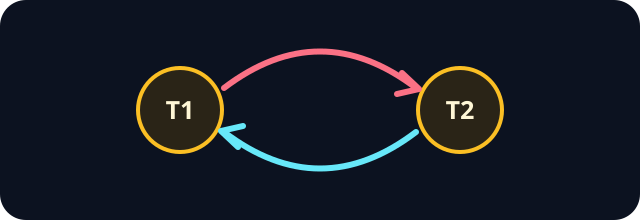

<div align="center">


<p><strong>A browser-based teaching tool for transaction schedules.</strong></p>
   
<br/>
</div>

## 🧭 Overview
Transaction Isolation Lab analyzes small database operation schedules. It builds a precedence graph, checks conflict serializability, and highlights selected read anomalies. It does not connect to or execute SQL against a database.

## ✨ Features
- 🧾 Parse read, write, commit, and abort operations.
- 🔀 Build conflict edges between transactions.
- 🔁 Check whether the precedence graph contains a cycle.
- ⚠️ Detect basic dirty-read and non-repeatable-read patterns.
- 🔒 Run the analysis entirely in your browser.

## 🎬 Demo
Start the app and load either built-in example. Edit the schedule to see how operation order changes the graph and anomaly report.

## 🚀 Quick Start
Requires Node.js 20 or newer.

```bash
npm start
```

Open http://127.0.0.1:4176. Run checks with npm test.

## 🧰 Tech Stack
- 🟢 Node.js built-in HTTP server
- 🌐 Browser JavaScript modules
- 🧪 Node.js built-in test runner

## 🗂️ Folder Structure
```text
public/       Schedule parser, analyzer, and interface
test/         Analyzer tests
assets/       Original SVG artwork
.github/      CI workflow
server.js     Dependency-free local server
```

## 🛣️ Roadmap
- [ ] Add recoverability and cascadelessness checks.
- [ ] Export precedence graphs as SVG.
- [ ] Add schedule step-through playback.

## 🤝 Contributing
Contributions are welcome. Keep the supported schedule grammar explicit and add focused tests for each anomaly detector.

## 📄 License
MIT. See LICENSE.

<div align="center"></div>
